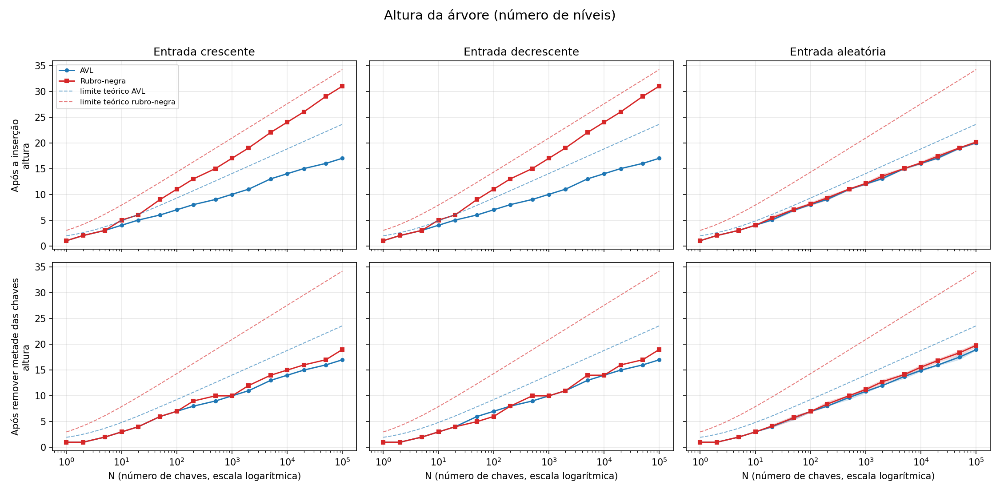
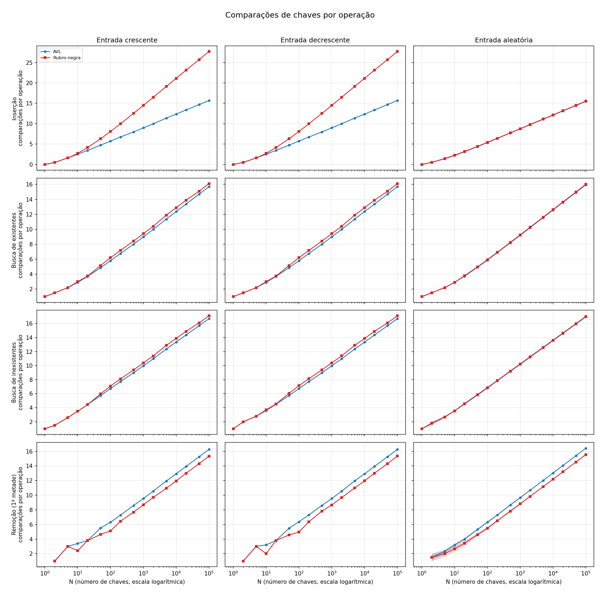
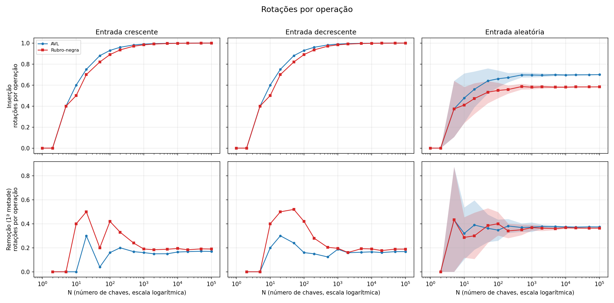
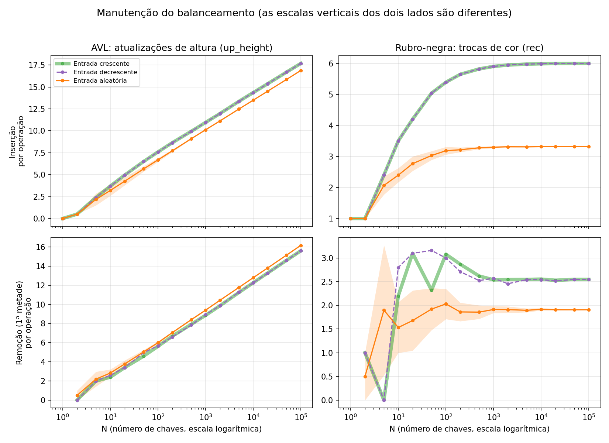

# Árvores AVL e Rubro-Negra 

## 1. Contexto e objetivo

Na Black Friday, um sistema de logística precisa **registrar, localizar e remover** identificadores de encomendas com eficiência. A ordem em que os dados chegam pode degradar uma árvore binária de busca comum (chaves em ordem crescente, por exemplo, transformam-na em uma lista encadeada). Este projeto implementa duas árvores de busca balanceadas, **AVL** e **Rubro-Negra**, e as compara com evidências medidas, para embasar uma recomendação técnica.

O projeto tem três partes:

1. **Implementação** das duas árvores em C++, sem bibliotecas prontas de balanceamento, com um programa interativo para usá-las.
2. **Testes de correção**, com cenários descritos em arquivos de texto.
3. **Experimento comparativo**, que mede o trabalho que cada árvore realiza (comparações, rotações e ajustes de balanceamento) e a altura final, e gera gráficos.

## 2. Estrutura do repositório

```
.
├── include/
│   ├── avl-tree.hpp          # struct do nó e declaração da classe AVLTree
│   └── rb-tree.hpp           # struct do nó e declaração da classe RedBlackTree
├── src/
│   ├── avl-tree.cpp          # implementação da AVL
│   ├── rb-tree.cpp           # implementação da rubro-negra
│   └── main.cpp              # programa interativo (escolha da árvore + comandos)
├── test/                     # cenários de teste (arquivos de comandos)
├── experimentos/
│   ├── script.py             # executa UMA combinação (árvore, padrão, N, semente)
│   ├── run_all.py            # percorre todas as combinações e grava o JSON
│   └── plot_results.py       # lê o JSON e gera os gráficos
├── resultados/
│   ├── resultados.json       # resultados brutos do experimento
│   └── graficos/             # altura.png, rotacoes.png, comparacoes.png, manutencao.png
└── README.md
```

## 3. Funcionalidades

Em ambas as árvores:

- **Inserção** de chaves inteiras;
- **Remoção** de chaves;
- **Busca** de chaves;
- **Percurso em ordem**, que apresenta as chaves em ordem crescente;
- **Impressão da estrutura** da árvore. Na rubro-negra, os nós são impressos com **cores ANSI** (vermelho e preto) e também com a letra `(R)` ou `(B)`, de modo que a cor seja identificável mesmo em terminais sem suporte a cores. Na AVL, cada nó mostra o **fator de balanceamento** `(fb=...)`.
- **Altura** da árvore (`HEIGHT`);
- **Contadores de trabalho** (`COUNTERS` e `RESET`), usados no experimento.

## 4. Como compilar e executar

### Requisitos

- Compilador C++ com suporte a C++11.
- Para o experimento e os gráficos: **Python 3** com a biblioteca **matplotlib**

### Compilação

Na raiz do repositório:

```bash
g++ -std=c++11 -Wall -Wextra src/*.cpp -Iinclude -o tree
```

### Execução

```bash
./tree
```

O programa pergunta qual árvore usar (`avl` ou `rb`) e passa a aceitar comandos, um por linha. Os comandos são em **maiúsculas** e diferenciam maiúsculas de minúsculas:

| Comando | Efeito |
|---|---|
| `INSERT valor` | insere a chave |
| `REMOVE valor` | remove a chave |
| `SEARCH valor` | busca a chave |
| `INORDER` | mostra as chaves em ordem crescente |
| `PRINT` | mostra a estrutura da árvore |
| `HEIGHT` | mostra a altura da árvore |
| `COUNTERS` | mostra os contadores de trabalho (uma linha) |
| `RESET` | zera os contadores |
| `-h` | mostra a ajuda |
| `END` | encerra o programa |

Como o programa lê a entrada padrão, também é possível executar um arquivo de comandos. A primeira linha do arquivo escolhe a árvore:

```bash
./tree < test/avl_insertion_in_order.txt
```

## 5. Decisões de projeto

O enunciado exige que as decisões sobre casos especiais sejam documentadas.

**Tratamento de casos especiais**

| Situação | Decisão |
|---|---|
| Inserir um valor que já existe | a árvore **não é alterada**; `insert` devolve `false` e o programa informa o usuário |
| Buscar um valor inexistente | `search` devolve `false`; nada é alterado |
| Remover um valor inexistente | `remove` devolve `false`; a árvore **não é alterada** |
| Operações em árvore vazia | busca e remoção devolvem `false`; `PRINT` e `INORDER` informam que a árvore está vazia |

As funções devolvem `bool`, e quem decide a mensagem mostrada ao usuário é o `main`.

**Remoção de nó com dois filhos.** Nas duas árvores, o nó é substituído pelo seu **sucessor** (a menor chave da subárvore direita), e o sucessor é removido de sua posição original.

**Altura.** A altura é contada em **nós**: árvore vazia = 0, árvore com um nó = 1. As duas árvores usam a mesma convenção, para que os valores sejam comparáveis.

**AVL.**
- Cada nó guarda a sua altura.
- Fator de balanceamento = altura(esquerda) − altura(direita); deve estar em {−1, 0, 1}.
- A implementação é recursiva: o rebalanceamento acontece no caminho de volta da recursão, tanto na inserção quanto na remoção.

**Rubro-negra.**
- Usa um **nó sentinela** `nil`, preto e compartilhado, no lugar de ponteiros nulos, e cada nó tem ponteiro para o pai.
- A implementação é iterativa e segue o esquema clássico (Cormen et al.), com as funções de correção `fixInsert` e `fixRemove`.

## 6. As duas estratégias de balanceamento

### AVL — balanceamento rígido pela altura

Depois de cada inserção ou remoção, a altura e o fator de balanceamento são recalculados no caminho de volta até a raiz. Se algum nó fica com fator fora de {−1, 0, 1}, uma ou duas **rotações** restauram o equilíbrio (casos esquerda-esquerda, direita-direita, esquerda-direita e direita-esquerda). Como o critério é rígido, a AVL é muito próxima do melhor caso e a altura fica limitada a cerca de 1,44·log₂ n.

### Rubro-Negra — balanceamento relaxado pelas cores

A árvore mantém cinco propriedades: (1) todo nó é vermelho ou preto; (2) a raiz é preta; (3) as folhas (`nil`) são pretas; (4) um nó vermelho não tem filho vermelho; (5) todos os caminhos de um nó até as folhas têm o mesmo número de nós pretos. Isso garante que o caminho mais longo não passe de cerca do dobro do mais curto, com altura limitada a cerca de 2·log₂ n.

## 7. Testes de correção

Os cenários estão em `test/`, como arquivos de comandos. Cada arquivo começa com o tipo da árvore (`avl` ou `rb`) e é executado com `./tree < arquivo`. Existem arquivos equivalentes para as duas árvores:

| Arquivo | Cenário |
|---|---|
| `*_insertion_in_order.txt` | inserção em ordem **crescente** (1 a 10), com `PRINT` após cada inserção, buscas e remoções |
| `*_insertion_in_desc_order.txt` | inserção em ordem **decrescente** (10 a 1) |
| `*_insertion_in_rand_order.txt` | inserção em ordem **não ordenada** (3, 10, 5, 8, 1, 6, 2, 4, 9, 7) |
| `*_empty_tree_one_element.txt` | operações em **árvore vazia** e em árvore com **um único elemento** |

**O que cada arquivo de inserção faz, e como se relaciona com o enunciado:**

| Item exigido no enunciado | Como é coberto |
|---|---|
| Inserção em ordem crescente, decrescente e não ordenada | os três pares de arquivos acima, com a mesma sequência de inserção nas duas árvores |
| Busca de elementos existentes e inexistentes | `SEARCH 5` e `SEARCH 7` (existem), `SEARCH 12` e `SEARCH 11` (não existem) |
| Remoção de nós com diferentes configurações de filhos | três remoções em cada arquivo: um **nó folha**, um **nó com um filho** e um **nó com dois filhos**, escolhidos na árvore que as inserções produziram |
| Remoção de elementos inexistentes | `REMOVE 15` e `REMOVE 16` (nunca inseridos); `REMOVE 14` na árvore vazia |
| Operações em árvore vazia e com um elemento | `*_empty_tree_one_element.txt` |
| Verificação do balanceamento após inserções e remoções | `PRINT` após cada operação: fatores de balanceamento na AVL e cores na rubro-negra |

## 8. Experimento comparativo

### 8.1 O que é medido, e por que não o tempo

O enunciado pede para discutir **altura final, rotações e ajustes de balanceamento**. Para isso, cada árvore tem **contadores** de trabalho, que são determinísticos e reproduzíveis (independem da máquina). Optou-se por **não medir tempo**: o tempo mistura o algoritmo com o estilo da implementação (a AVL aqui é recursiva e a rubro-negra é iterativa) e com a máquina, e não diz *por que* uma árvore foi mais rápida.

| Contador | Árvore | O que conta |
|---|---|---|
| `compare` | ambas | comparações de chaves durante a descida (busca, inserção e remoção) |
| `rot` | ambas | rotações (uma rotação dupla conta 2) |
| `rec` | rubro-negra | **recolorações**: toda atribuição de cor executada em `fixInsert` e `fixRemove` |
| `up_height` | AVL | atualizações de altura de nós (equivalente da AVL ao "ajuste" da rubro-negra) |

**Regras de contagem, para interpretar os números corretamente:**

- `rec` conta **toda atribuição de cor executada**, mesmo quando a cor já era a mesma. Não entram a cor inicial vermelha do nó novo nem a cópia de cor feita na remoção com dois filhos (`y->color = z->color`).
- `rec` e `up_height` **medem coisas diferentes** e não são comparáveis em valor absoluto. Compara-se apenas a **forma** das curvas.
- **Assimetria no `compare` da remoção:** na remoção de um nó com dois filhos, a AVL desce uma segunda vez (recursivamente) para remover o sucessor, e essa descida é contada. A rubro-negra encontra o sucessor com a função `minimum`, que **não** é contada. Por isso, a rubro-negra parece fazer menos comparações na remoção; isso não é uma vantagem do algoritmo.
- Contadores medem **trabalho**, não **velocidade**.

### 8.2 Desenho do experimento

Cada execução cria **uma árvore nova**, insere N chaves e depois faz buscas e remoções. As duas árvores recebem **exatamente as mesmas chaves**, nas mesmas ordens.

- **Chaves:** os N números **pares** (2, 4, ..., 2N) são inseridos. As buscas de **inexistentes** usam os **ímpares** (1, 3, ..., 2N−1), que ficam espalhados entre as chaves existentes. Isso evita um viés: usar chaves maiores que todas as existentes faria todas as buscas descerem pelo mesmo caminho (o mais à direita).
- **Padrões de entrada:** crescente, decrescente e aleatório.
- **Tamanhos:** 1, 2, 5, 10, 20, 50, 100, 200, 500, 1.000, 2.000, 5.000, 10.000, 20.000, 50.000 e 100.000. Em passos geométricos, ficam igualmente espaçados em escala logarítmica e mostram o crescimento da menor à maior árvore.
- **Sementes:** crescente e decrescente são determinísticos (1 execução). O aleatório usa **30 sementes** (1 a 30); a mesma semente produz a mesma ordem de chaves nas duas árvores. A variação entre sementes é grande para N pequeno (em N = 10, as rotações por inserção variam cerca de 45% entre sementes) e cai rapidamente com N, por isso o número de sementes foi escolhido com folga.
- **Total:** 16 tamanhos × 2 árvores × 32 execuções (1 + 1 + 30) = **1.024 resultados**.

**Fases de cada execução** (com `RESET` entre elas, para que cada contador meça só a sua fase):

1. inserção das N chaves;
2. busca das N chaves existentes;
3. busca das N chaves inexistentes;
4. remoção das N chaves, em **ordem aleatória** (a mesma para as duas árvores).

Os contadores e a altura são lidos **no meio da remoção** (após N/2 remoções) e **no final**. Isso dá o custo de remover de uma árvore ainda grande (primeira metade) sem perder o custo total, e uma altura final informativa (remover tudo deixaria a altura em 0). Nos gráficos de remoção, usa-se a **primeira metade**; por isso a curva dessa fase começa em N = 2, já que com N = 1 ela tem zero operações.

Cada contador é **dividido pelo número de operações da fase**, para obter o custo médio por operação e permitir comparar tamanhos diferentes.

### 8.3 Arquitetura e como reproduzir

O programa em C++ cria uma única árvore por execução. O Python faz o papel de orquestrador:

```
script.py  --(monta comandos, executa ./tree, lê a saída, confere)-->  1 combinação
run_all.py --(percorre todas as combinações)-------------------------->  resultados/resultados.json
plot_results.py --(lê o JSON)----------------------------------------->  resultados/graficos/*.png
```

- O C++ **não escreve JSON** nem lê arquivos: o Python entrega os comandos pela entrada padrão e interpreta as linhas `COUNTERS ...` e `Height: ...` da saída. Isso evita depender de bibliotecas de JSON em C++ e garante que os números saem do **mesmo executável** do repositório.
- O `script.py` **confere** cada execução: o número de inserções, remoções, buscas encontradas e não encontradas deve ser exatamente N. Se algo divergir, o experimento para com uma mensagem de erro, em vez de gravar números errados.
- O `run_all.py` grava o JSON **a cada tamanho concluído**, então nada se perde se a execução for interrompida.

**Para reproduzir** (da raiz do repositório):

```bash
g++ -std=c++11 -Wall -Wextra src/*.cpp -Iinclude -o tree      # 1. compilar
python3 experimentos/run_all.py                                # 2. rodar o experimento (alguns minutos)
python3 experimentos/plot_results.py                           # 3. gerar os gráficos
```

Um teste rápido, que grava fora do repositório:

```bash
python3 experimentos/run_all.py --tamanhos 1 2 5 --sementes 2 --saida /tmp/teste.json
```

Para inspecionar uma única combinação:

```bash
python3 experimentos/script.py avl aleatorio 1000 --semente 3
```

**Formato do JSON.** O arquivo tem duas chaves: `configuracao` (tamanhos, número de sementes, árvores e padrões) e `resultados`, uma lista em que cada item traz: `arvore`, `padrao`, `n`, `semente`, `operacoes` (número de operações de cada fase), `contadores` (valores brutos por fase: `insercao`, `busca_existente`, `busca_inexistente`, `remocao_1a_metade` e `remocao_2a_metade`) e `altura` (`apos_insercao` e `apos_metade_das_remocoes`).

## 9. Resultados

Todos os gráficos têm N em escala logarítmica no eixo X. No padrão aleatório, a linha é a **média das 30 sementes** e a faixa sombreada é ±1 desvio padrão. Os valores citados abaixo são aproximados, lidos para **N = 100.000**; os valores exatos estão em `resultados/resultados.json`.

### Altura



As linhas tracejadas são os **limites teóricos** (fórmulas da literatura, e não dados medidos): para a AVL, `1,4405·log₂(n+2) − 0,3277`; para a rubro-negra, `2·log₂(n+1) + 1` (em níveis). Todas as 1.024 execuções ficaram abaixo dos limites.

- Em entrada **ordenada** (crescente ou decrescente), a AVL fica com altura 17 e a rubro-negra com 31.
- Em entrada **aleatória**, as duas ficam muito próximas, em torno de 20.
- Depois de remover metade das chaves, as alturas se aproximam: 17 (AVL) e 19 (rubro-negra) nas entradas ordenadas.

### Comparações



- **Inserção em entrada ordenada:** a rubro-negra faz cerca de 27,7 comparações por inserção, contra 15,7 da AVL. Inserir em ordem sempre desce pelo caminho mais à direita (ou esquerda), que é justamente o mais alto na rubro-negra. Em entrada aleatória, as duas são idênticas.
- **Busca:** as duas são muito próximas; a AVL faz cerca de 0,4 comparação a menos por busca em entrada ordenada, e em entrada aleatória o resultado é praticamente igual. Isso vale para chaves existentes e inexistentes.
- **Remoção:** a rubro-negra aparece com menos comparações, mas isso reflete a assimetria de contagem descrita na seção 8.1.

A altura e as comparações medem coisas diferentes: a altura é o **pior caminho**, e as comparações por busca são o **caminho médio**. Por isso a rubro-negra pode ter altura 31 contra 17 e, ainda assim, custar só cerca de 0,4 comparação a mais por busca: poucos caminhos são muito longos, e a maioria das buscas não passa por eles.

### Rotações



- **Inserção em entrada ordenada:** as duas ficam em torno de 1,00 rotação por inserção.
- **Inserção em entrada aleatória:** 0,70 na AVL e 0,58 na rubro-negra.
- **Remoção:** valores próximos nas duas árvores (cerca de 0,17 contra 0,19 em entrada ordenada, e 0,37 contra 0,36 em entrada aleatória).

### Manutenção do balanceamento



Os painéis da AVL e da rubro-negra têm **escalas verticais diferentes**, e o que se compara é a forma da curva.

- A `up_height` da AVL **cresce com log N**: chega a cerca de 17,7 atualizações por inserção em entrada ordenada (16,9 em aleatória) e a cerca de 16 por remoção.
- A `rec` da rubro-negra **se estabiliza** com N: cerca de 6,0 por inserção em entrada ordenada (3,3 em aleatória) e cerca de 2,5 por remoção (1,9 em aleatória).

Em outras palavras, o trabalho de manutenção por operação da rubro-negra é praticamente constante, enquanto o da AVL cresce com a altura da árvore.

### Síntese

| Aspecto | O que os dados mostram |
|---|---|
| Altura em entrada ordenada | AVL mais baixa (17 contra 31) |
| Altura em entrada aleatória | empate |
| Custo médio de busca | AVL ligeiramente menor em entrada ordenada; empate em aleatória |
| Custo de inserção (comparações) em entrada ordenada | AVL bem menor (15,7 contra 27,7) |
| Rotações por inserção | empate em entrada ordenada; rubro-negra menor em aleatória |
| Rotações por remoção | praticamente iguais |
| Manutenção do balanceamento | rubro-negra constante; AVL cresce com log N |

## 10. Limitações

- Os contadores medem **quantidade de trabalho**, não **tempo de execução**. Não se pode concluir daqui que uma árvore é "mais rápida", apenas que faz mais ou menos trabalho de um determinado tipo.
- `rec` e `up_height` não são diretamente comparáveis entre si (seção 8.1).
- O contador `compare` da remoção favorece artificialmente a rubro-negra (seção 8.1).
- Em entradas crescente e decrescente há **uma única execução** por tamanho, com uma única ordem de remoção. Por isso, as curvas de remoção nesses padrões oscilam para N pequeno e só se estabilizam a partir de algumas centenas ou milhares de chaves.
- Crescente e decrescente são casos **espelhados**, e dão resultados quase idênticos (nos gráficos de manutenção, a linha da entrada crescente é desenhada mais grossa, atrás da decrescente, para que as duas apareçam).
- As chaves são inteiros, e o experimento usa chaves distintas, sem repetição.
- Os limites teóricos desenhados nos gráficos são resultados da literatura, e não dados medidos.
- A verificação de balanceamento nos testes de correção é feita por inspeção, sem função automática.

